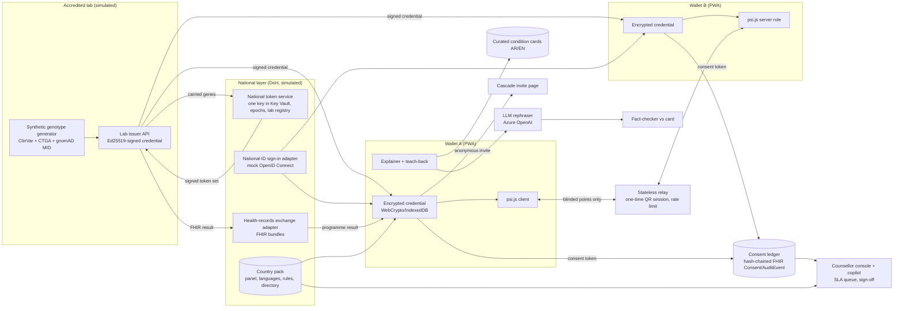

# 💡 BLAZE · IDEA: AMANA: a carrier wallet that lets a couple learn their shared genetic risk without showing anyone their full carrier list

> **Type:** 💡 IDEA (🛠️ product/project). Not built yet.
> **For:** Future Health Digital Innovation Challenge, Fertility · Challenge 03 *Understanding and Reducing Inherited Disease Risk* (https://hack2skill.com/event/futurehealthchallenge/) · **Team:** 4 (assumed: 1 ML/LLM, 2 full-stack, 1 design + clinical content) · **Deadline:** prototype 20 Nov 2026 (17 days from 3 Nov) · **Budget:** free tiers + Azure credits
> **Projected score:** **68/100** blind-panel median, as built by this team at the deadline. Statistical tie with the runner-up, so the tiebreak is documented in I3. **~74/100** if the panel-flagged fixes in I5 land. · **Feasibility:** 4/5 · **Risk:** M
> **Updated 4 Nov 2026:** scalability changes added: one national token service, two modes (programme + private), national-ID and health-records adapters, tiered counselling, content pipeline, country packs and a scale panel (features I-F12..I-F16). Estimated **~76/100** with these plus the I5 fixes. This is our estimate from the rubric math in I5, not a re-run of the blind panel. Build plan: `IMPLEMENTATION_PLAN.md`.
> **Assumptions:** team composition, budget and equal criterion weights are inferred (the official page lists the six criteria with no weights). The user named the event, not a challenge, so the challenge choice is part of this ideation. Whether Emirati Genome Programme participants can get their own carrier results is **not verified** (see R6). · **Brief provenance:** official page + FAQ, read in a browser 2026-11-03; `notes/brief.md`
> **Companion skills used:** caveman ✓ · adhd ✓ (5 frames × 6 ideas) · novelty-assessment ✓ (see I4) · blind 3-scorer panel ✓ (`notes/panel.md`)

---

## I1. The problem (evidence-backed)
- **Who hurts:**
  - Emirati couples in Abu Dhabi's mandatory premarital genetic test: 570 genes, 840+ recessive disorders, mandatory since Oct 2024 / Jan 2025. From 2022 to Jul 2026, **11,748 couples were tested and 565 (≈5%) were incompatible** [T2 Gulf News, 3 Oct 2026](https://gulfnews.com/uae/health/abu-dhabi-genetic-screening-flags-565-incompatible-cases-among-couples-1.500697261) · [T2](https://gulfnews.com/uae/health/explained-mandatory-genetic-tests-in-uae-to-protect-future-generations-1.104274156).
  - Their relatives (carrier status is shared across families).
  - The 100+ physicians trained to deliver results [same source].
- **Context:**
  - Consanguinity in the UAE is a long-standing norm: 50.5% of marriages, with 26.2% first-cousin, in the last national study (1994–95) [T1](https://research.uaeu.ac.ae/en/publications/consanguineous-marriages-in-the-united-arab-emirates/).
  - The Emirati Genome Programme holds 750k+ samples [T2](https://enterpriseam.com/uae/2025/11/07/uae-targets-global-leadership-in-genomics/).
  - CTGA lists 665 genetic conditions described in Emiratis [T1](https://pmc.ncbi.nlm.nih.gov/articles/PMC10194840/).
- **Current workaround and why it fails:**
  - The programme flags only couples where *both* carry the same mutation [Gulf News 2026].
  - Everything else is labelled "compatible", so carriers in ≈95% of couples get no structured education, family follow-up or cascade testing.
  - The check happens late, at the marriage-contract stage, when an incompatible result is socially costly.
  - Results are explained by trained family physicians, not by dedicated genetic counsellors, and the public record mentions no partner or family disclosure controls.
  - In Saudi Arabia's long-running mandatory programme, **37.1% of incompatible couples married anyway** [T1 PMC7898212](https://pmc.ncbi.nlm.nih.gov/articles/PMC7898212) (search summary, page not opened, so verify before pitching). Informed, values-sensitive support matters more than a pass/fail verdict.
- **Top pain points (ranked by evidence):**
  1. Results arrive late and as a binary verdict. Couples cannot explore their risk privately and early (Gulf News 2026; Dor Yeshorim's anonymous early model exists because of this [T2](https://www.tabletmag.com/sections/community/articles/tinder-for-tay-sachs)).
  2. Fear of exposure. Genetic results are shared family information, and the PS explicitly requires "avoiding exposure of one family member's information to another without permission" (PS text).
  3. Comprehension. Carrier status, recessive inheritance and the "25% per pregnancy" figure are hard to grasp. No Arabic genetic-counselling assistant exists (3 searches; `notes/research_track_fertility.md`).
  4. Counselling capacity. Result delivery depends on a limited pool of trained physicians.
- **Success looks like (PS item 6):**
  - Better comprehension (teach-back score), counselling uptake, time from result to counselling, cascade invites sent and accepted, and zero unauthorised disclosures.
  - Equal performance in Arabic and English and across literacy levels.
  - Cancelled marriages are never counted as success.

## I2. Landscape & white space
| Existing solution | Type | Link | What it does well | Where it fails (the opening) |
|---|---|---|---|---|
| Abu Dhabi premarital genetic programme | Gov programme | [Gulf News](https://gulfnews.com/uae/health/abu-dhabi-genetic-screening-flags-565-incompatible-cases-among-couples-1.500697261) | Scale, mandate, 570 genes, Malaffi data flow | Late, binary, physician-delivered; no carrier follow-up; no user-controlled sharing |
| Dor Yeshorim | Community programme | [doryeshorim.org](https://doryeshorim.org/?p=53367) | Reveals couple compatibility only; anonymous IDs; works early | Trusted central database; individuals can't see their own status; paternalistic |
| Baldi et al. "Countering GATTACA" | Research (ACM CCS 2011) | [arXiv 1110.2478](https://arxiv.org/abs/1110.2478) | Private set operations for compatibility tests | Academic prototype; inputs not authenticated; no counselling or UX |
| QOMPLX US12373600B1 | Patent (2024 priority) | [Google Patents](https://patents.google.com/patent/US12373600) | Homomorphic-encryption couple compatibility; shows progeny result only | US; HE not PSI (summary mentions no PSI); no counselling or cascade. **Freedom-to-operate check needed** |
| Nucleus Genomics "multiplayer" | US direct-to-consumer | [Fortune](https://fortune.com/well/article/genetic-matching-feature-parents-ceo-eugenics) | Couple risk across 900+ conditions | $399/person; criticised as eugenics; not values-sensitive; no Arabic |
| Invitae Gia | Rule-based chatbot | [invitae.com/gia](https://invitae.com/gia) | Intake, results delivery, counsellor booking | English/US, oncology-weighted; no consanguinity framing |
| Orchid / JScreen | Couple reports / tele-counselling | [orchidhealth.com](https://www.orchidhealth.com/) | Counsellor-backed couple reports | IVF-centric or community-specific; no privacy-preserving partner flow |

**White space:** "Reveal only the couple-relevant result" (the Dor Yeshorim property) achieved with **cryptography instead of a trusted custodian**, plus **user-held, tiered, revocable disclosure** (self → partner → relatives), plus an **Arabic-first, comprehension-checked explainer** and **counsellor routing**, all fitting *inside* a mandatory national programme. Nothing found combines these. Also open: **consented anonymous cascade** for carriers in "compatible" couples.

**Overdone (avoid):** generic LLM health chatbot · mood/fitness apps (W1/W2 very crowded, `notes/research_track_context.md`) · dashboards with no closed action · "AI fertility score".

## I3. Idea selection
| # | Candidate (challenge) | Core insight | Projected score (panel median) | Feasibility | Wow | Risk | Verdict |
|---|---|---|---|---|---|---|---|
| 1 | **AMANA** (F3) | Couple-only reveal via authorised PSI + user-held consent; serves carriers the programme ignores | **68** (67.75) | 4 | 4.3 | M | ✅ chosen |
| 2 | HEATLEDGER (P4) | Physiology-based (ISO 7933 PHS) heat strain from live weather + workload; worker-held data; employer gets attestations only | 69 (68.5) | 5 | 3.3 | M | 🔁 pivot backup |
| 3 | CLOSURE (P2) | FHIR state machine with NHS-failsafe owners/SLAs; closure only with evidence | 63 | 4 | 2 | M | parked |
| 4 | RAJUL (F1) | Anonymous-first men's reproductive triage | 49 | 4 | 2 | M | parked |

- **Panel spread:** max 1.0 per criterion, so no adjudication was needed and panel confidence is High.
- **Candidates:** 30 adhd + 2 remix generated, 4 shortlisted, 26 killed or merged (log in `notes/candidates.md`).
- **Tiebreak (rule fixed before the novelty result, `notes/panel.md`):** the 0.75-point gap is inside the panel noise. AMANA wins on four counts:
  1. Lower competition: F3 is low, P4 is medium.
  2. Higher wow: 4.3 vs 3.3.
  3. AMANA's weak rows (Scalability 5.5, Commercial 5.5) are positioning gaps this spec fixes. HEATLEDGER's weak rows come from an unvalidated individual safety alert, which can't be validated in 17 days and carries liability.
  4. Technical depth: 7.5 vs 6. All three scorers called HEATLEDGER an assembly of existing parts.

## I4. The solution
- **One-liner:** For Emirati couples and families going through premarital genetic screening, who fear late surprises and family exposure, AMANA is a private carrier wallet. It lets two people learn *only* whether they share risk in the same gene, explains it in plain Arabic or English, and routes them to a counsellor. Unlike Dor Yeshorim or the current programme, no central party and no partner ever sees your full carrier list.
- **Core insight (why it works when others don't):**
  - Privacy is the barrier to *early* and *family-wide* action, so make it **provable, not promised**. A national token service (run for DoH) turns each lab-certified carrier gene into an unforgeable token. It uses one national key, so tokens match whichever accredited lab did the test. A couple runs **Authorized PSI** on those tokens: only lab-certified elements can be input ([De Cristofaro, Kim, Tsudik 2010, eprint 2010/469](https://eprint.iacr.org/2010/469)).
  - Neither partner can probe for genes they don't carry. The relay server sees only blinded points.
  - The result is a single bit ("shared-gene risk: yes/no"). Naming the condition needs a second, mutual consent.
  - This also fixes a weakness our engineering scorer found in naive PSI: with a 570-gene universe, an unauthenticated party could submit every gene and recover the other's full list.
- **Two modes (added 4 Nov for scale):**
  - **Programme mode:** the national lab match runs as today. AMANA delivers the result, the person's own carrier cards, counsellor routing and family invites. It reaches every tested person, including carriers in "compatible" couples.
  - **Private mode:** the authorised private check above, for couples who want to check early and privately.
  - This makes AMANA an add-on to the national programme, not a rival to it.
- **Novelty vs closest prior art:**

| Closest existing | Link | Our difference | novelty-assessment |
|---|---|---|---|
| Baldi 2011 (private genomic compatibility) | [arXiv](https://arxiv.org/abs/1110.2478) | Authorised inputs (lab-signed tokens), tiered consent, counselling, cascade, Arabic | **not_novel (high)** as crypto: same PSI core |
| Dor Yeshorim | [link](https://doryeshorim.org/?p=53367) | No trusted central database; the user can know their own status; user-controlled sharing | same reveal-only policy, different trust model |
| QOMPLX patent | [link](https://patents.google.com/patent/US12373600) | Different primitive (authorised ECDH-PSI vs HE); counselling and cascade layers; GCC programme fit | closest IP; FTO needed |
| Digital cascade tools (GIFT, FH Family Share, DNA-poli) | [GIM Open 2025](https://doi.org/10.1016/j.gimo.2025.103456) | Anonymised invites reusing consent tokens; consanguinity framing; Arabic | invites are established practice |

**Novelty verdict (`notes/novelty.md`):** the cryptographic core is a **re-implementation** (Baldi 2011; QOMPLX 2024). It is new as an **integration, setting and evaluation**: (a) consent-gated two-stage disclosure (a cardinality bit, then the condition only on mutual signed, revocable consent); (b) consanguinity-aware anonymous cascade; (c) **an Arabic/English explainer with teach-back, measured on Emirati users, plus an Arabic genetic-counselling evaluation set**. No Arabic genetic-counselling LLM evaluation was found, which makes (c) the most publishable piece. **Pitch the comprehension and counselling outcomes first and the cryptography second.**

- **User journey:**
  1. **Receive.** After screening (or from a participating lab), Mariam gets a signed carrier credential in AMANA, stored encrypted on her phone. AMANA greets her in Arabic: "You carry one change in *HBB*. Carriers are healthy. Here's what this means for you." A 3-question teach-back follows.
  2. **Pair.** Before families formalise anything, Mariam and Khalid scan each other's one-time QR in person. Both consent to a *compatibility check only*.
  3. **Check.** Authorised PSI runs in both browsers. Result: "No shared-gene risk found among the 570 genes screened". Or: "Shared-gene risk found. A counsellor can explain your options." Neither sees the other's other carrier genes.
  4. **Reveal (optional).** If both tap "show which condition", they see the condition card (e.g. β-thalassaemia, 25% per pregnancy, the range of options described non-directively), and a counsellor slot is offered within the SLA.
  5. **Counsel.** The counsellor sees only what the couple shared. The copilot pre-fills a case summary and the evidence card. The counsellor signs off before anything is labelled clinical advice.
  6. **Cascade (optional).** Mariam sends anonymous invite links to siblings: "A relative of yours learned they carry a genetic change. Testing is available." The invite doesn't say who sent it or which gene.
  7. **Control.** Every share is a signed, expiring, revocable consent token, and Mariam's audit log shows who saw what and when.

## I5. Rubric fit (how this idea earns each point)
Baseline is the panel median. The target assumes the fixes listed land.

| Criterion | Weight | Panel | Target | How the idea scores here | Evidence/plan |
|---|---|---|---|---|---|
| Health impact & clinical relevance | 17 | 7 | 8 | Programme mode reaches every tested person, not only couples who run the private check. A national mandatory programme (11,748 couples so far) plus carriers in the ≈95% "compatible" couples plus cascade. Targets earlier counselling, not cancelled marriages | Simulated cohort calibrated to the observed ≈5% incompatibility (I11); comprehension pilot n≥20 |
| Technical depth & architecture | 17 | 7.5 | 7.5 | Authorized PSI on lab-signed tokens, W3C-style verifiable credential, hash-chained FHIR Consent ledger, guarded bilingual explainer with fact-check, consanguinity-aware simulator | Enumeration-attack test that fails; threat model vs malicious partner; PSI benchmarks across the 570-gene panel. Novelty check: crypto not novel, so depth comes from integration + authorised inputs |
| Working solution & demo | 17 | 7 | 8 | Two phones on stage, live PSI, Arabic RTL, counsellor console receiving the case | Offline-safe path (I12) |
| Responsible AI, safety & data governance | 17 | 8 | 8.5 | Provable minimal disclosure, non-directive content, counsellor sign-off, LLM never states facts outside curated cards, fairness by language/literacy | Model card + DPIA-style data map + red-team log |
| Scalability & deployment | 16 | 5.5 | 7 | **Fix:** add-on layer to the existing programme with two modes (I-F13); one national token service so any accredited lab works (I-F12); national-ID sign-in and health-records exchange adapters (I-F14); tiered counselling so counsellor time scales (I-F7); country packs for GCC (I-F16). Labs issue credentials (FHIR Consent + Observation shape, Malaffi-compatible); stateless relay; Azure UAE North for data residency | Architecture I7; scale panel: 100,000-couple load test, cost per couple, cross-lab test (I-F10); deployment guide |
| Commercial viability & path to pilot | 16 | 5.5 | 6.5 | **Fix:** named pilot path (DoH/ADPHC programme + one screening lab). Per-screened-person SaaS licence. GCC expansion: Saudi Arabia's mandatory premarital programme since 2004, ~150k marriages/yr (secondary figure) [T1 PMC7898212](https://pmc.ncbi.nlm.nih.gov/articles/PMC7898212) | 1-page pilot proposal in submission |
| **Total** | 100 | **68** | **~76** (estimate, not panel-scored) | | |

---
## 🛠️ PROJECT SECTIONS

## I6. Features
| ID | Feature | MVP / Stretch | Acceptance criterion (testable) | Owner |
|---|---|---|---|---|
| I-F1 | **Lab issuer** (simulated accredited lab): issues the signed carrier credential (carrier genes + programme couple result) and gets the person's tokens from the national token service (I-F12) | MVP | `POST /issue` returns a credential whose Ed25519 signature verifies; a changed byte fails verification; 1,000 synthetic people issued in <30 s | C |
| I-F2 | **Synthetic population generator**: consanguinity-aware carrier panels from ClinVar pathogenic variants in CTGA genes + gnomAD MID / GME frequencies | MVP | Simulated couple-incompatibility rate within ±1.5 pp of the observed 4.8% (565/11,748) at a stated consanguinity mix; seed reproducible | A |
| I-F3 | **Wallet PWA** (Arabic RTL + English): import credential, encrypted at rest (WebCrypto AES-GCM, IndexedDB), own-results view | MVP | Credential unreadable in IndexedDB without the device key; Lighthouse PWA installable; full Arabic UI with no English leakage on core screens | B |
| I-F4 | **Couple check via authorised PSI** (OpenMined `psi.js` 2.0.6 cardinality mode → optional reveal mode) over a stateless relay with one-time QR pairing | MVP | Shared-gene pairs detected = ground truth on 1,000 synthetic couples (0 FN / 0 FP); relay logs contain no plaintext genes; a forged token (not lab-signed) is rejected | B |
| I-F5 | **Mutual-consent reveal**: condition named only after both consent; signed, expiring, revocable consent tokens; hash-chained audit log (FHIR `Consent` + `AuditEvent` shape) | MVP | Revoking a token blocks later reads (test); tampering with any log entry breaks chain verification | C |
| I-F6 | **Explainer + teach-back**: curated condition cards (top 25 CTGA conditions incl. the 6 most common incompatible ones named by DoH); LLM only rephrases to reading level; numeric/claim fact-check against the card; 3-question teach-back | MVP | 0 unsupported claims on a 100-prompt red-team set; Arabic and English cards reviewed by 1 clinician advisor (named, or flagged "pending review"); teach-back stored | A + D |
| I-F7 | **Counsellor console + copilot** with 3 tiers (Tier 1 self-serve education for carriers in compatible couples; Tier 2 group or on-demand chat; Tier 3 one-to-one with SLA for shared-gene or incompatible results), pre-filled summary, non-directive options list, mandatory human sign-off | MVP | Case appears ≤5 s after consent; 1,000 simulated cases routed to the correct tier; no case data visible without consent token; "clinical advice" label impossible without sign-off | C |
| I-F8 | **Enumeration-attack demo**: attacker submits all 570 genes → rejected | MVP | Scripted attack fails with logged reason; naive-PSI comparison shows the leak AMANA prevents | B |
| I-F9 | **Anonymous cascade invites** to relatives (no sender, no gene) + booking link | Stretch | Invite page reveals no sender identity or gene (manual + automated check); acceptance tracked in aggregate only | B |
| I-F10 | **Evaluation + scale dashboard**: comprehension pre/post, time-to-counselling (simulated), disclosure incidents, fairness by language/literacy with small-cell suppression (<5); scale panel: 100,000-couple relay load test, phone timing, cost per couple per year (AED), cross-lab test | MVP | Renders from real pilot data + simulation; suppresses cells <5; load-test and cost figures come from measured runs | A (load test with C) |
| I-F11 | Voice read-aloud of cards (Arabic TTS) for low literacy | Stretch | Every card playable; tested with 2 low-literacy users | D |
| I-F12 | **National token service**: per-gene tokens `t_g = HMAC(k_nat, gene‖epoch)` from one national key held in managed key storage; only registered labs can call it; signs each token set | MVP | Same gene from Lab A and Lab B gives the same token; unregistered lab refused; token request for a gene not in the person's lab-signed credential refused; tokens change each epoch | C |
| I-F13 | **Programme mode**: wallet receives the lab's official couple result as a credential and shows own carrier cards, next steps and counsellor routing | MVP | A carrier in a "compatible" couple gets their own carrier card and education; an "incompatible" result routes to Tier 3 | B |
| I-F14 | **Integration adapters** (mock): national-ID sign-in via standard OpenID Connect; results delivered as FHIR bundles through a health-records-exchange adapter | MVP (mock) | Swapping the mock sign-in for a real provider needs config only; result bundle validates as FHIR | C |
| I-F15 | **Content pipeline**: draft from public sources → translation draft → clinician review → versioned publish; coverage metric | MVP (lite) | 25 cards reviewed; dashboard shows the share of simulated incompatible matches covered by reviewed cards | D + A |
| I-F16 | **Country packs**: gene panel, languages, rules, counsellor directory and tier rules as config | MVP (lite) | Switching from the Abu Dhabi pack to a second demo pack changes panel, language default and directory with no code change | C |

MVP = I-F1..F8 + F10 + F12..F16 (F14 as mocks, F15–F16 in lite form). I-F9 and I-F11 are stretch. These IDs are what `/blaze project` audits as "planned vs built".

## I7. Architecture

- **Components:**
  - **Lab issuer** (FastAPI): holds the lab signing key. Issues signed credentials (carrier genes + programme result).
  - **National token service** (FastAPI): holds the single national token key `k_nat` in Azure Key Vault. Serves registered labs only, rotates by epoch, and can switch a lab off instantly.
  - **Adapters:** mock national-ID sign-in (OpenID Connect) and health-records exchange (FHIR bundles), swappable for real providers by config.
  - **Country packs:** config bundles for gene panel, languages, rules and counsellor directory.
  - **Wallet** (Next.js PWA, RTL): stores, explains, pairs, consents.
  - **Relay** (Node/WebSocket, stateless): forwards PSI messages and never persists them.
  - **Ledger** (Postgres append-only, hash chain, FHIR JSON shapes).
  - **Console** (Next.js): counsellor queue with 3 tiers.
  - **Explainer service:** card store, LLM rephrase, rule-based fact-check.
  - **Simulator + eval** (Python).
- **Authorised-PSI flow (MVP construction):**
  1. The lab sends each person's carried genes to the national token service. It returns tokens `t_g = HMAC(k_nat, g‖epoch)` for those genes only, plus a signature over the token set. One national key means tokens match across labs.
  2. Both wallets verify each other's set signature against the token-service public key, exchanged via the relay at pairing.
  3. They run ECDH-PSI (OpenMined) on the tokens in cardinality mode, so the output is the count only.
  4. On mutual reveal consent, they rerun in intersection mode, and each wallet maps intersecting tokens back to genes it already knows.
- **Security properties:**
  - Neither party can test genes outside their own lab-signed set.
  - The relay sees only blinded elements.
  - The lab, which already knows both sets, learns nothing new.
  - The national token service learns each person's carried genes at issue time, as the lab already does, and keeps no gene list. An oblivious token protocol, so it learns nothing, is roadmap.
- **Stated limitation:** this assumes honest-but-curious wallets plus lab-signed inputs. A full malicious-secure APSI ([eprint 2010/469](https://eprint.iacr.org/2010/469)) is future work.
- **Data flow:** synthetic genotype → lab credential → wallet (on device) → blinded PSI over relay → 1 bit → (mutual consent) → condition card + counsellor case → teach-back + metrics.
- **API / screens:**
  - Endpoints: `POST /issue` · `GET /lab/pubkey` · `POST /tokens` (registered labs only) · `GET /tokens/pubkey` · `WS /relay/:session` · `POST /consent` · `POST /consent/:id/revoke` · `GET /audit/:subject` · `GET /cases` (counsellor) · `POST /cases/:id/signoff` · `POST /invite` · `GET /packs/:country`
  - Screens: Welcome/language · Sign in · My result · Programme result · Teach-back · Pair (QR) · Check result · Reveal consent · Counsellor booking · Sharing & audit · Invite relatives · Counsellor queue/case
- **Storage schema sketch:**
  - `credential` (device only)
  - `lab_registry(lab_id, pubkey, status, registered_at)`
  - `token_epoch(epoch, starts_at, ends_at, key_version)`
  - `consent(id, subject_hash, grantee_hash, scope, expires_at, revoked_at, sig)`
  - `audit(id, prev_hash, hash, actor_hash, action, consent_id, ts)`
  - `case(id, couple_session_hash, condition_code?, tier, status, sla_due, counsellor_id, signoff_ts)`
  - `card(condition_code, lang, reading_level, body, sources[], reviewer, version)`
  - `metric_event(type, lang, literacy_band, ts)` (no identifiers)

## I8. Tech stack & building blocks
| Layer | Choice | Why (vs alternative) | Link | License / cost | Verified usable? |
|---|---|---|---|---|---|
| PSI | OpenMined PSI (`psi.js` / `openmined.psi` 2.0.6) | ECDH-PSI with cardinality mode, browser + Python. APSI (SEAL) is heavier and built for unbalanced sets | https://github.com/OpenMined/PSI | Apache-2.0, free | ✅ repo active (pushed 2026-09-22); npm + PyPI 2.0.6 resolved 2026-11-03 |
| Signatures/tokens | Ed25519 + HMAC-SHA256 (WebCrypto / PyNaCl) | Standard, no custom crypto | — | free | standard library |
| Key storage | Azure Key Vault | Lab signing keys and the national token key never leave managed key storage; supports rotation | https://learn.microsoft.com/azure/key-vault/ | credits | standard |
| Sign-in adapter | Mock OpenID Connect provider | Same standard flow a national ID provider uses, so a real one replaces it by config | — | free | mock only |
| Load test | k6 or Locust (chosen on 11 Nov) | Standard open-source load tools | https://k6.io · https://locust.io | free | standard |
| Frontend | Next.js PWA, RTL via `dir="rtl"`, Tailwind logical properties | One codebase for wallet + console | — | MIT, free | standard |
| Backend | FastAPI (issuer, explainer) + Node WS relay | Team velocity | — | MIT/BSD | standard |
| LLM | Azure OpenAI (GPT-4o-class), rephrase only | Microsoft is co-creator; Azure UAE North region. BiMediX2 is research-only (CC-BY-NC-SA) so it is unusable commercially | https://github.com/mbzuai-oryx/BiMediX2 (rejected for licence) | credits | BiMediX2 licence ✅ checked by research agent |
| Ledger | Postgres (Azure / Supabase free) | Append-only table + hash chain; FHIR JSON shapes, so no FHIR server is needed for MVP | — | free tier | standard |
| Variants | ClinVar via NCBI E-utilities | Pathogenic variants per gene | https://www.ncbi.nlm.nih.gov/clinvar/ | NCBI: no use restrictions | ✅ API returned 425 pathogenic HBB records, 2026-11-03 |
| Gene/condition list | CTGA (Centre for Arab Genomic Studies) | Conditions reported in Emiratis | https://cags.org.ae/en/ctga-overview | open access, terms unstated → cite, don't redistribute | ✅ site HTTP 200, 2026-11-03 |
| Frequencies | gnomAD v4 (Middle Eastern group) / Greater Middle East Variome | Realistic carrier rates | https://gnomad.broadinstitute.org/news/2023-11-gnomad-v4-0/ · https://pmc.ncbi.nlm.nih.gov/articles/PMC5019950 | gnomAD open; GME licence unverified | partially (licence check task D1) |

**Datasets / data sources:**

| Name | Link | Size | License | Access |
|---|---|---|---|---|
| ClinVar | https://www.ncbi.nlm.nih.gov/clinvar/ | millions of records | public domain-like | API |
| gnomAD v4 MID frequencies | https://gnomad.broadinstitute.org | per-variant | open | browser/API |
| CTGA | https://cags.org.ae/en/ctga-overview | 665 Emirati conditions | open access, terms unstated | web |
| Synthetic population (ours) | generated | 10k people / 5k couples | ours | repo |

All data is public or synthetic and declared, per the FAQ: "use only data you have the legal right to use".

## I9. Build plan
The full day-by-day plan (4–20 Nov), component plans, gates, testing plan and cut order are in **`IMPLEMENTATION_PLAN.md`**. Key dates:

| Date | Milestone |
|---|---|
| Wed 4 Nov | Team registered; private check runs between two browsers |
| Thu 5 Nov | **Gate 1:** in-browser private check, or the helper-service fallback |
| Sat 7 Nov | Two phones pair by QR and get "shared risk: yes/no" |
| Mon 9 Nov | Attack demo works; sign-in through the adapter |
| Tue 10 Nov | Registration deadline (registration already done on 4 Nov) |
| Thu 12 Nov | **Gate 2:** demo-able end to end on staging (~60%) |
| 13–15 Nov | User test (≥20 adults); load test; demo environment live |
| Mon 16 Nov | **Gate 3:** feature freeze |
| Thu 19 Nov | Submit |
| Fri 20 Nov | Official deadline, kept as buffer |

- **Cut order if time runs short:** Arabic read-aloud → real FHIR server → family invites → live country-pack switch → Tier 2 sessions → 100,000-couple load test (report 10,000 and say so).
- **Never cut:** private check, signed tokens, attack demo, consent + audit log, reviewed cards with fact-check, counsellor sign-off, programme mode, evaluation numbers.

## I10. Risks & fallbacks
| # | Risk | Likelihood | Impact | Early warning sign | Fallback (plan B) |
|---|---|---|---|---|---|
| R1 | psi.js browser build friction (WASM) | M | H | D2 spike fails | Run the PSI client in a Python sidecar (`openmined.psi`) behind each wallet; same protocol, demo unchanged |
| R2 | Arabic explainer produces a wrong or unsafe claim | M | H | Red-team pass rate <100% | Disable LLM paraphrase and ship curated cards only (still bilingual, still teach-back) |
| R3 | No clinician advisor recruited | M | M | None by D5 | Cards cite GeneReviews/MedlinePlus Genetics verbatim-paraphrased with sources; label "pending clinical review"; say so in limitations |
| R4 | Judges see "marriage filtering" / eugenics | M | H | Pitch feedback | Non-directive copy reviewed against the PS ("informed choice, not judgement"); metrics exclude marriage decisions; show the options list includes proceeding without intervention |
| R5 | Patent/FTO concern (QOMPLX HE patent) | L | M | Judge Q | Different primitive (authorised ECDH-PSI) and cited prior art from 2010–2011; recommend formal FTO before pilot |
| R6 | Credential source unclear in the real programme (EGP results return not verified) | M | M | Judge Q | Position the issuer as the screening lab that already issues the premarital result; EGP integration is phase 2 |
| R7 | Comprehension pilot too small / skewed | H | M | <20 participants by 15 Nov | Report as a feasibility pilot with CIs; add the simulated-case evaluation the PS allows ("realistic or simulated cases") |
| R8 | Small-universe privacy is overstated | L | H | Engineering judge probes | Show the enumeration attack failing; state the honest-but-curious assumption + lab-signed inputs; malicious APSI as roadmap |
| R9 | Couples tested at different labs don't match (per-lab token keys) | — | H | Cross-lab test fails | **Fixed by design:** one national token service (I-F12); cross-lab test run 6 Nov and 16 Nov |
| R10 | Real national-ID and health-records connections need government onboarding | H | M | Judge Q | Mock adapters on standard protocols; integration page lists what a real connection needs and who provides it |
| R11 | Azure OpenAI model not available in UAE North | M | L | Day-1 check | Nearest region; only synthetic data is sent; stated in docs |
| R12 | National token service is a single point of failure or trust | M | M | Engineering judge probes | Key in managed key storage with rotation; lab registry with instant switch-off; oblivious token protocol on the roadmap |

## I11. Evaluation plan (how we'll prove it works)
- **Correctness:** shared-gene detection on 5,000 synthetic couples vs ground truth. Target 100% exact (deterministic protocol), reported with protocol latency on a mid-range phone.
- **Cross-lab:** the same gene tested at two labs gives the same token, and couples tested at different labs are matched correctly.
- **Scale:** 100,000 simulated couple checks through the relay (time per check, error rate), one check on a mid-range phone, and cost per couple per year in AED from measured server use.
- **Realism:** simulator incompatibility rate vs the observed 4.8% (565/11,748), with the consanguinity mix stated. Sensitivity curve from unrelated to first-cousin couples.
- **Privacy:**
  - Enumeration attack (570-gene probe) rejected 100%.
  - Relay logs grep shows 0 plaintext genes.
  - Revocation test.
  - Hash-chain tamper test.
  - Baseline for comparison: naive PSI leaks the full list.
- **Safety:** 100-prompt red-team (Arabic, English, code-switched) on the explainer. Target 0 unsupported claims and 0 directive statements, reviewed by 2 people.
- **Comprehension (PS item 6):**
  - n≥20 adults, Arabic + English, mixed education.
  - Teach-back score before vs after the explainer, compared with the plain lab-letter text as baseline.
  - Report by language and literacy band, suppressing cells <5.
- **Access (simulated):** time from result to counselling slot vs current path (assumption documented); share of carriers in "compatible" couples reached by education.
- **Never measured as success:** cancelled marriages (PS item 6).

## I12. Demo & pitch
- **3-minute demo script:**
  - **0:00 Hook.** "565 couples in Abu Dhabi learned they share a genetic risk, at the marriage-contract stage. Thousands more carriers learned nothing."
  - **0:30 Problem.** Late, binary, family exposure; no Arabic counselling help.
  - **1:00 Live.** Two phones. Mariam's result in Arabic → teach-back → QR pair with Khalid → check runs → "Shared-gene risk found" → both tap reveal → β-thalassaemia card → counsellor console lights up with an SLA timer.
  - **1:50 Wow.** An attacker phone tries all 570 genes and is rejected on screen. "Nobody, not even our server, can see your list."
  - **2:15 Impact + scale.** Simulator calibrated to 4.8%; comprehension pilot result; fairness table by language; scale panel (100,000-couple load test, cost per couple, Abu Dhabi → UAE → Saudi rollout with a live country-pack switch).
  - **2:45 Ask.** Pilot with DoH/ADPHC + one screening lab; GCC programmes next.
- **Offline-safe demo path:** both wallets plus the relay run on a local laptop hotspot. The LLM is pre-cached for demo personas, with a curated-card fallback. A recorded backup video is ready.
- **Impact numbers (sourced):** 11,748 couples tested / 565 incompatible (Gulf News 2026) · 570 genes / 840+ disorders · consanguinity 50.5% (1994–95) · Saudi Arabia: 37.1% of incompatible couples married anyway (PMC7898212) · 665 conditions in Emiratis (CTGA).
- **Judge Q&A:**

| Likely question | Answer |
|---|---|
| The lab already sees both results; why PSI? | The lab isn't the threat. Partners, families and the app operator are. AMANA lets couples check early, before the formal programme, and share only one bit. It also serves carriers in "compatible" couples, whom the programme doesn't follow up. |
| Isn't this enabling marriage filtering? | It is built to be non-directive: no recommendations, the options list includes proceeding without intervention, counsellor sign-off is required, and the success metric is comprehension and counselling uptake, never cancelled marriages (as the PS requires). |
| Can someone brute-force 570 genes? | Not with AMANA. Only lab-signed tokens can be input. We demo the attack failing. |
| Is the LLM giving medical advice? | No. It only rephrases curated, sourced, clinician-reviewed cards, a fact-checker blocks unsupported claims, and the counsellor signs off. |
| Business model? | A per-screened-person licence to the programme or the lab; the counsellor copilot cuts session prep time; GCC premarital programmes are the expansion market. |
| How does this scale nationally? | Programme mode works for every tested person from day one. One national token service serves all accredited labs. Checks run on phones and the relay stores nothing, so server cost per couple is small (measured in the scale panel). Counsellor time is spread across 3 tiers. |
| What if we were tested at different labs? | Tokens come from one national service with one key, so they match whichever lab tested you. We demo it. |

- **Sustainability:** B2G/B2B licence. The stateless relay and on-device data keep hosting cost low and simplify data-residency compliance.

## I13. Ethics, privacy & compliance
- **Data:** synthetic only in the prototype, with every public source declared (FAQ). No real genomes.
- **Consent:** granular (check / reveal / share-with-named-person / cascade), expiring, revocable, logged.
- **Data minimisation:** genes stay on device; the server holds hashes and consent metadata only. The national token service handles carried genes only when tokens are issued and keeps no gene list.
- **Non-directive design:** the PS forbids coercion. Copy is reviewed for judgement and stigma (language around consanguinity, carrier ≠ ill) and avoids gendered blame. Women carriers face extra stigma (clinician scorer's objection), so the default is no sharing without explicit opt-in.
- **Regulation:** UAE Federal Law No. 2 of 2019 on ICT in health fields and DoH data standards (to be confirmed with an advisor; not verified in this run). Decision support only, not a diagnostic device.
- **Licences:** BiMediX2 excluded (non-commercial). CTGA content cited, not redistributed. QOMPLX FTO flagged.
- **Fairness:** Arabic/English parity, literacy bands, voice read-aloud (stretch). Metrics reported with small-cell suppression.

---
## I14. Sources
All 71 sources are in `blaze/sources.md`, tagged `[idea]`. Searched as of 2026-11-03. Opened vs search-summary status is recorded per source in the notes files ([O]/[S]). Re-open these before pitching: Saudi PMC7898212 · eprint 2010/469 · the 1994–95 UAE consanguinity study · the Abu Dhabi FIT 30.5% figure (runner-up only).
Notes: `notes/brief.md`, `notes/research_track_context.md`, `notes/research_track_fertility.md`, `notes/research_track_pophealth.md`, `notes/adhd_raw.md`, `notes/candidates.md`, `notes/panel.md`, `notes/novelty.md`.

## Next
Build it following `IMPLEMENTATION_PLAN.md` → `/blaze project` (audits the build against I6 features and the same rubric) → `/blaze fix`. Re-plan: `/blaze idea --pick 2` develops HEATLEDGER (P4) instead.
