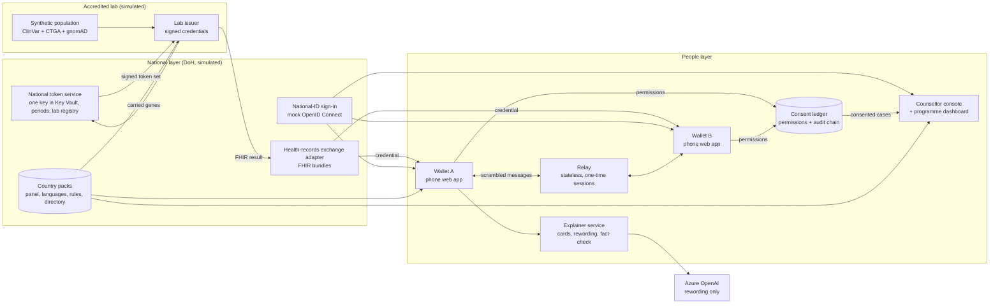
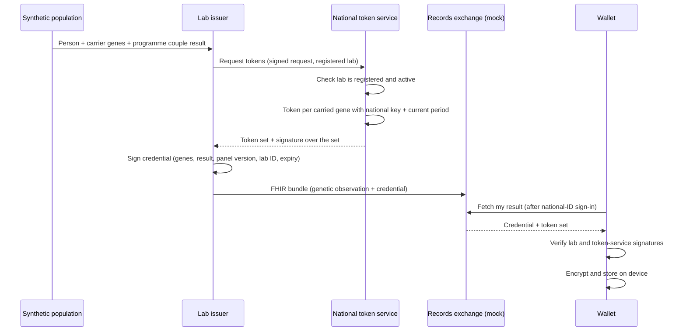
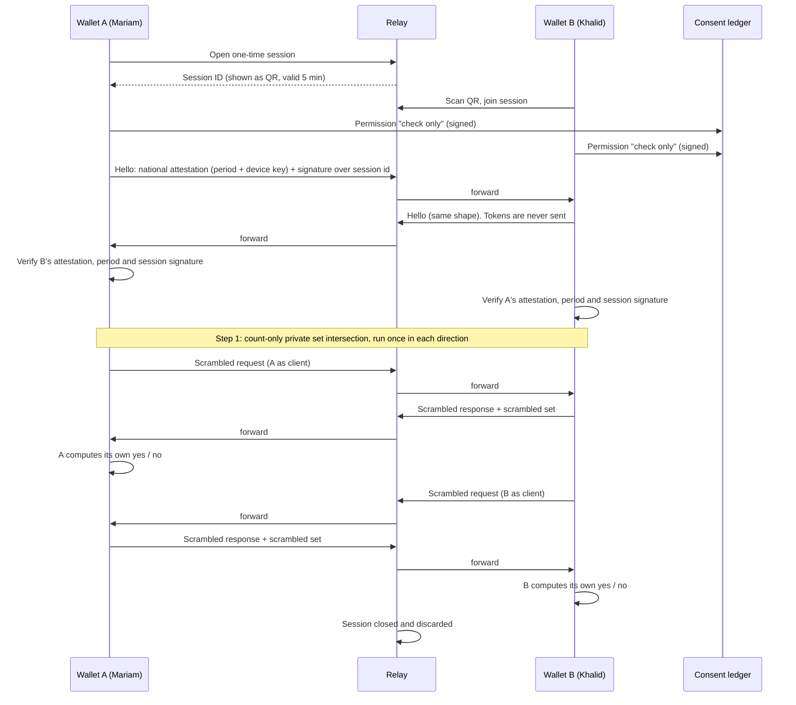
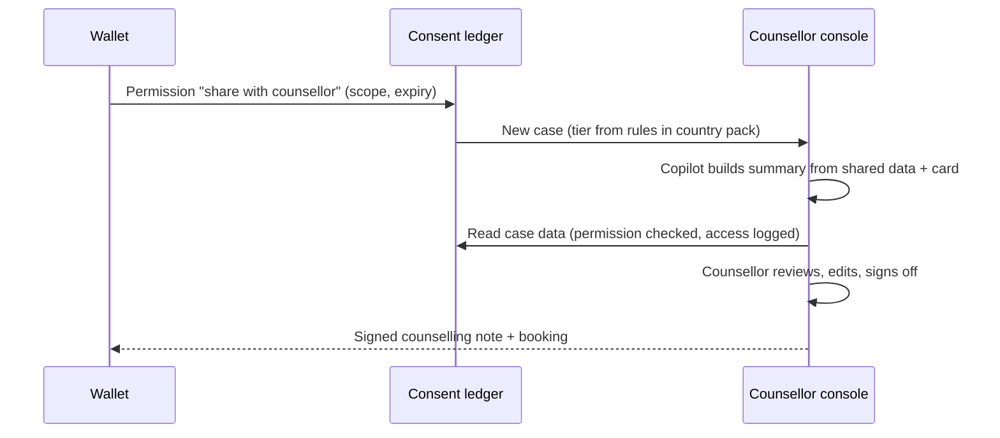

# AMANA: Architecture

> How AMANA is built: system parts, app flows, data, APIs, security, deployment, folder and file structure, and tech stack.
> **Related docs:** `PRD.md` (what and why) · `rules.md` (what to use and avoid) · `phases.md` (build order) · `design.md` (UI).
> Feature IDs (I-F1 … I-F16) match `PRD.md`.

---

## 1. System overview

AMANA has three layers:

1. **National layer (simulated DoH services):** a national token service, a mock national-ID sign-in, a mock health-records exchange, and country packs (configuration).
2. **Lab layer (simulated accredited lab):** the lab issuer, fed by the synthetic population generator.
3. **People layer:**
   - The **wallet** app on each person's phone, which stores results, explains them and runs the private check.
   - The **relay**, which passes scrambled messages between two phones.
   - The **consent ledger**, the **explainer service** and the **counsellor console** (which also hosts the programme dashboard).

**Key design choice:** genetic data lives only on the phone (and at the lab, which already has it). Servers see scrambled data, permissions and audit entries, never a person's carrier list.

### 1.1 Component diagram



### 1.2 Components

| Component | Feature | Responsibility | Holds | Never holds |
|---|---|---|---|---|
| National token service | I-F12 | Makes per-gene tokens with one national key; registers labs; rotates periods | National key (in Key Vault), lab registry, period table | Any stored gene list |
| Lab issuer | I-F1 | Signs credentials (carrier genes + programme couple result); requests tokens | Lab signing key (in Key Vault), issuance log | — (it is the lab; it already knows results) |
| Synthetic population | I-F2 | Generates realistic fake people, families and couples | Synthetic data only | Real data |
| Health-records exchange adapter | I-F14 | Delivers results as FHIR bundles; mock of the real exchange | Delivery log | Long-term copies of results |
| National-ID sign-in | I-F14 | Signs people and counsellors in via OpenID Connect (mock) | Mock accounts | Genetic data |
| Wallet | I-F3, I-F4, I-F13 | Stores the credential encrypted; explains; pairs; runs the check; manages permissions | Encrypted credential and tokens, on device only | — |
| Relay | I-F4 | Forwards scrambled check messages between two wallets in a one-time session | Nothing on disk; session in memory for up to 5 minutes | Gene names, unscrambled tokens |
| Consent ledger | I-F5 | Stores permissions and a tamper-evident audit chain | Permission records, audit entries (hashed identities) | Genes |
| Explainer service | I-F6, I-F15 | Serves reviewed cards; rewords; fact-checks; records teach-back | Cards, teach-back answers (no identity) | Personal identity |
| Counsellor console | I-F7, I-F10 | Tiered case queue, copilot summary, sign-off; programme dashboard | Consented case data only | Non-consented data |
| Country packs | I-F16 | Configuration: panel, languages, rules, tiers, directory | Config files | — |

---

## 2. App flows

### 2.1 Issuing a result (lab → token service → wallet)



### 2.2 Programme mode (every tested person)

1. The person signs in and the wallet imports the credential (2.1).
2. The wallet shows **My result**: each carrier gene as a reviewed condition card.
3. Teach-back runs (3 questions per card).
4. If the credential includes a **programme couple result**:
   - **Compatible, no carriers:** short explanation; no action needed.
   - **Compatible, one or both carriers:** own carrier education; Tier 1 (self-serve); optional family invite.
   - **Incompatible:** explanation; offer to share with a counsellor; Tier 3 case created after consent.

### 2.3 Private mode: the couple check



**Step 2: reveal which condition (only if both agree)**
1. Both people tap "show which condition".
2. Each wallet sends the partner a consent signed with its device key, and writes a signed "reveal condition" permission to the ledger.
3. The check runs again in **intersection mode**, once in each direction: each wallet learns which of **its own** tokens are shared, and maps them back to genes it already knows. A wallet answers a reveal request only after both signed consents.
4. The wallet shows the condition card and offers a counsellor (Tier 3).

**Why a cheat fails (I-F8):**
- An attacker who claims every gene on the panel cannot produce valid tokens for genes they don't carry, because tokens need the national key.
- A forged attestation, an old period or a replayed hello fails before any matching starts.
- Tokens never leave the phone, so a partner cannot compare tokens directly and skip the consent steps.
- Each phone answers at most one count request and one reveal request per session, so a partner cannot re-ask with single genes.
- Each phone computes its own result, so neither can lie to the other about yes or no.
- The demo shows both rejections with the logged reason.

### 2.4 Counselling



**Tier rules (from the country pack):**

| Tier | Who | Service | Time target |
|---|---|---|---|
| 1 | Carriers in compatible couples; anyone wanting more information | Self-serve cards + teach-back | none |
| 2 | Questions after Tier 1; low-risk concerns | Group session or on-demand chat | set in pack |
| 3 | Shared-gene risk (private mode) or incompatible programme result | One-to-one counsellor | set in pack (shown as a timer) |

### 2.5 Family invites (stretch, I-F9)
1. The carrier chooses relatives' contact method outside the app (they send the link themselves).
2. The wallet creates an invite link with a random ID and a "family invite" permission.
3. The invite page says only that someone in the family thinks they may want to learn about carrier screening, that carriers are usually healthy, and links to general information. It does not even say that the sender is a carrier.
4. The page **never** shows the sender or the gene. Acceptance is counted in aggregate only.

### 2.6 Revoking and deleting
- **Revoke:** the wallet marks the permission revoked in the ledger; the ledger refuses later reads at once; the revoke is logged.
- **Delete my data:** the wallet revokes all permissions, deletes the device key and the encrypted store, and confirms.

---

## 3. Data model

### 3.1 On the device (wallet only, encrypted)

| Item | Contents |
|---|---|
| Credential | Person reference, carrier genes, panel version, test date, programme couple result, lab ID, expiry, lab signature |
| Token set | One token per carried gene, period, token-service signature |
| Device key | Non-exportable key used to encrypt the above |
| Teach-back progress | Card IDs completed (no answers with identity sent to servers) |

### 3.2 Server tables

| Table | Fields | Owner service |
|---|---|---|
| `lab_registry` | lab_id, public_key, status, registered_at | Token service |
| `token_period` | period, starts_at, ends_at, key_version | Token service |
| `issuance_log` | id, lab_id, person_hash, panel_version, issued_at | Lab issuer |
| `consent` | id, subject_hash, grantee_hash, scope, expires_at, revoked_at, signature | Consent ledger |
| `audit` | id, prev_hash, hash, actor_hash, action, consent_id, timestamp | Consent ledger |
| `case` | id, couple_session_hash, condition_code (optional), tier, status, sla_due, counsellor_id, signoff_at | Console |
| `card` | condition_code, language, reading_level, body, sources, reviewer, review_status, version | Explainer |
| `teachback_result` | card_id, language, literacy_band, score, timestamp (no identity) | Explainer |
| `metric_event` | type, language, literacy_band, timestamp (no identity) | Dashboard |

**Standards shapes:** `consent` and `audit` are stored in FHIR **Consent** and **AuditEvent** shapes; results travel as a FHIR **Bundle** with a genetic **Observation**.

---

## 4. APIs

| Service | Method and path | Purpose | Who may call |
|---|---|---|---|
| Lab issuer | `POST /issue` | Issue a credential for a person | Lab staff (internal) |
| Lab issuer | `GET /lab/pubkey` | Lab public key | Anyone |
| Token service | `POST /tokens` | Token set for a person's carried genes | Registered labs only |
| Token service | `GET /tokens/pubkey` | Token-service public key | Anyone |
| Token service | `POST /labs` · `POST /labs/:id/disable` | Register or switch off a lab | DoH admin |
| Records exchange (mock) | `GET /results/me` | Fetch my credential as a FHIR bundle | Signed-in person |
| Relay | `WS /relay/:session` | One-time check session | Two paired wallets |
| Consent ledger | `POST /consent` · `POST /consent/:id/revoke` | Grant / revoke a permission | Wallet |
| Consent ledger | `GET /audit/:subject` | My audit log | The person (signed in) |
| Explainer | `GET /cards/:code?lang=&level=` | Reviewed card, optionally reworded | Wallet |
| Explainer | `POST /teachback` | Record teach-back result (no identity) | Wallet |
| Console | `GET /cases` · `GET /cases/:id` | Case queue / case detail (permission-checked) | Counsellor |
| Console | `POST /cases/:id/signoff` | Sign off a counselling note | Counsellor |
| Console | `GET /dashboard` | Programme metrics (aggregated) | Programme manager |
| Invites (stretch) | `POST /invite` · `GET /i/:id` | Create / view anonymous invite | Wallet / anyone with link |
| Packs | `GET /packs/:country` | Country pack | All services |

### 4.1 What the prototype serves (`services/demo-api`)
One FastAPI app plays the labs, token service, ledger, explainer and console for the demo. It never holds
wallets and has no endpoint that returns anyone's genes after delivery; the check itself runs on the
phones over `services/relay`.

| Path | Purpose | Proof the caller is allowed |
|---|---|---|
| `POST /api/signin`, `POST /api/enroll` | Mock national-ID sign-in; deliver the lab-signed result + national tokens once, bound to the device key | Signed ID token |
| `GET /api/pack`, `GET /api/directory` | Panel size; counsellors and free slots from the country pack | Public |
| `GET /api/card/{code}` | Card in sections | Public (no personal data) |
| `GET /api/card/{code}/key`, `POST /api/ask` | Server copy of "simpler words" and question answering (console, evaluation). The wallet does not call them: see 4.2 | Public |
| `POST /api/teachback`, `GET /api/study` | Anonymous quiz answers; study material | Public, no identity stored |
| `POST /api/consent` | Signed permission: check, reveal, share with a counsellor (opens a case: scope, question, slot), family invite | Device-key signature |
| `POST /api/revoke`, `POST /api/withdraw` | Revoke one / everything | Device-key signature |
| `POST /api/sharing`, `POST /api/my-cases` | My permissions and audit log; my cases and signed-off notes | Device-key signature, fresh within 2 min |
| `GET /api/invite/{id}`, `POST /api/invite/{id}/accept` | Anonymous invite page; count acceptance | Anyone with the link |
| `GET /api/cases`, `GET /api/case/{id}`, `GET /api/case/{id}/status`, `POST /api/case/{id}/signoff`, `POST /api/case/{id}/label` | Queue (no personal data, not logged); case (consent-checked, logged); draft ready?; sign-off; label | Mock counsellor sign-in + live permission |
| `GET /api/dashboard`, `GET /api/attack`, `GET /api/ai` | Metrics; attack demo; whether the AI is on | Public (aggregates only) |

### 4.2 Questions answered on the phone (`apps/wallet/lib/ask`)
Questions are personal, so the wallet answers them itself and sends nothing.

| File (wallet) | What it does |
|---|---|
| `public/ask/index.json` (~40 KB) | Reviewed sentences of every card in both languages, card names, section of each sentence, and the safety rules, exported from `services/explainer` by `scripts/build_ask_index.py` |
| `public/ask/static-64/` (4.9 MB, optional) | Static multilingual embedding model (token vectors, int8, 64 dims), with SHA-256 sums and tuned weights in `model.json` |
| `lib/ask/engine.ts` | Same rules as the server: decision questions get the fixed reply; answers are whole reviewed sentences; with the model, sentences are picked by meaning |
| `lib/ask/wordpiece.ts`, `static-embed.ts` | Tokenizer (matches the official one) and mean-of-token-vectors embedding |
| `lib/ask/load.ts` | Chooses the level per phone (rules on phones under 1 GB or without storage), asks before downloading (says when on mobile data), checks sums, caches in the Cache API, removes on request |

Levels and results: `docs/model-card.md` §1.

---

## 5. Security architecture

### 5.1 Threat model (summary)

| Who might attack | What they want | Mitigation |
|---|---|---|
| Curious partner | Learn my other carrier genes | Count-only check first; reveal needs both consents; intersection shows only shared genes |
| Cheating partner | Claim every gene on the panel to learn my full list | Tokens need the national key; token-set signature checked before the check |
| Relay operator | Learn genes from traffic | Relay sees only scrambled values; stores nothing |
| AMANA operator / database leak | Learn people's results | No gene lists on servers; identities hashed; permissions required for case data |
| Family member with my phone | Read my results | Device encryption; app lock; content hidden when the app is in the background |
| Network attacker | Read or alter traffic | TLS everywhere; signatures on credentials and token sets |
| Rogue or compromised lab | Issue false results | Lab registry; instant switch-off; issuance log |
| Replay of old tokens | Track people or reuse tokens | Tokens tied to a period; expired periods rejected |

### 5.2 Stated limitations
- Assumes phones are honest-but-curious plus lab-signed inputs; a fully malicious-secure protocol is roadmap.
- The national token service sees carried genes at issue time (as the lab does) and keeps no gene list; an oblivious token protocol is roadmap.
- National-ID sign-in and the records exchange are mocks.

---

## 6. Deployment

### 6.1 Environments

| Environment | Where | Purpose |
|---|---|---|
| Local | Docker Compose on each laptop | Development |
| Staging | Azure UAE North | Integration tests, nightly full-flow run |
| Demo | Azure UAE North | Judges' URL, seeded demo personas |
| Offline demo | One laptop + hotspot | Stage backup: wallets, relay and services run locally |

### 6.2 Azure resources

| Resource | Used for |
|---|---|
| Azure Container Apps | All services and both web apps |
| Azure Database for PostgreSQL (flexible server) | Ledger, cases, cards, metrics |
| Azure Key Vault | Lab signing key, national token key, app secrets |
| Azure OpenAI | Card rewording (UAE North if the model is available; otherwise nearest region, synthetic data only, documented) |
| Azure Monitor / Log Analytics | Logs (with gene and token scrubbing) |
| GitHub Actions | CI: lint, tests, build, deploy to staging |

---

## 7. Folder and file structure

```
amana/
├── README.md                       how to run, demo personas, links to docs
├── package.json                    root scripts for the JS workspace
├── pnpm-workspace.yaml             JS workspace definition
├── pyproject.toml                  Python workspace (uv)
├── docker-compose.yml              local stack: Postgres, services, relay, mock sign-in
├── .env.example                    every variable listed, no real values
├── .github/
│   └── workflows/
│       ├── ci.yml                  lint, type-check, tests on every pull request
│       └── deploy-staging.yml      deploy main to staging
├── apps/
│   ├── wallet/                     phone web app (Next.js)
│   │   ├── app/[locale]/
│   │   │   ├── welcome/            language choice + intro
│   │   │   ├── sign-in/            national-ID sign-in
│   │   │   ├── result/             my result (carrier cards)
│   │   │   ├── teach-back/[card]/  3-question check
│   │   │   ├── programme/          programme couple result
│   │   │   ├── pair/               show / scan QR
│   │   │   ├── check/              check progress + result
│   │   │   ├── reveal/             two-step reveal consent
│   │   │   ├── book/               counsellor booking
│   │   │   ├── sharing/            permissions + audit log
│   │   │   ├── invite/             family invites (stretch)
│   │   │   └── settings/           language, app lock, delete my data
│   │   ├── components/             wallet-only components
│   │   ├── lib/
│   │   │   ├── vault/              device key + encrypted storage
│   │   │   ├── verify/             credential and token-set signature checks
│   │   │   ├── psi/                private check client (browser library or helper fallback)
│   │   │   ├── relay/              session client
│   │   │   └── consent/            permission requests
│   │   ├── messages/
│   │   │   ├── ar.json             Arabic strings (gender-aware variants)
│   │   │   └── en.json             English strings
│   │   ├── public/manifest.webmanifest
│   │   └── tests/                  unit + end-to-end tests
│   └── console/                    counsellor console + programme dashboard (Next.js)
│       ├── app/[locale]/
│       │   ├── queue/              tiered case queue
│       │   ├── case/[id]/          case detail, copilot summary, sign-off
│       │   ├── dashboard/          evaluation + scale dashboard
│       │   └── attack-demo/        "claim every gene on the panel" demo screen
│       ├── components/
│       ├── messages/ar.json, en.json
│       └── tests/
├── packages/
│   ├── ui/                         shared design-system components (see design.md)
│   ├── schemas/                    shared data shapes: credential, token set, permission, case
│   └── config/                     shared lint, format and type-check settings
├── services/
│   ├── token-service/              national token service (FastAPI)
│   │   ├── app/                    routes: tokens, labs, pubkey; periods; registry
│   │   └── tests/
│   ├── lab-issuer/                 lab issuer (FastAPI)
│   │   ├── app/                    routes: issue, pubkey; signing; FHIR bundle builder
│   │   └── tests/
│   ├── relay/                      relay (Node + WebSocket)
│   │   ├── src/                    sessions, limits, forwarding
│   │   └── tests/
│   ├── consent-ledger/             permissions + audit chain (FastAPI)
│   │   ├── app/
│   │   └── tests/
│   ├── explainer/                  cards, rewording, fact-check, teach-back (FastAPI)
│   │   ├── app/
│   │   └── tests/
│   └── adapters/
│       ├── mock-signin/            mock OpenID Connect provider
│       └── records-exchange/       mock health-records exchange (FHIR bundles)
├── packs/
│   ├── abu-dhabi/
│   │   ├── pack.yaml               languages, legal text refs, tier rules, time targets
│   │   ├── panel.csv               gene panel + version
│   │   └── directory.yaml          counsellors and booking slots (synthetic)
│   └── demo-country-2/             second pack to show config-only expansion
├── content/
│   └── cards/<condition-code>/
│       ├── ar.md                   Arabic card
│       ├── en.md                   English card
│       ├── teachback.yaml          3 questions per language
│       └── meta.yaml               sources, reviewer, review status, version
├── sim/
│   ├── generator/                  synthetic population (families, marriages, carriers)
│   ├── eval/                       correctness, cross-lab, privacy, simulation metrics
│   └── data/                       downloaded public data (not committed)
├── redteam/
│   ├── prompts/                    100 red-team prompts (Arabic, English, mixed)
│   └── results/                    reviewed runs
├── loadtest/
│   └── scenarios/                  10,000 and 100,000 couple-check scenarios
├── infra/
│   └── azure/                      infrastructure templates for staging and demo
├── docs/
│   ├── PRD.md · architecture.md · rules.md · phases.md · design.md
│   ├── decisions.md                decision log
│   ├── threat-model.md             full threat model
│   ├── model-card.md               what the AI may and may not do
│   ├── data-map.md                 every data source and where data flows
│   ├── integration.md              what is mocked and what a real connection needs
│   ├── deployment-guide.md         how a lab and DoH would onboard
│   └── limitations.md              assumptions, dependencies, limitations
└── pitch/
    ├── deck/                       pitch deck
    ├── video/                      3-minute video + backup demo recording
    └── pilot-proposal.md           1-page pilot proposal
```

---

## 8. Tech stack

Exact versions are pinned in lockfiles at project start. Only versions checked during research are listed here.

| Layer | Choice | Why | Notes |
|---|---|---|---|
| Private check | OpenMined PSI: `psi.js` (browser) and `openmined.psi` (Python), 2.0.6 | Maintained, Apache-2.0, has count-only mode, runs in browsers | Checked 3 Nov 2026. Fallback: Python helper service per wallet |
| Signatures | Ed25519 (WebCrypto in the browser where supported; PyNaCl on servers) | Standard, fast, small keys | No custom crypto |
| Tokens | HMAC-SHA256 with the national key | Standard keyed hash | Key lives in Key Vault |
| Device storage | WebCrypto AES-GCM + IndexedDB | Built into browsers | Non-exportable device key |
| Web apps | Next.js + TypeScript + Tailwind CSS | One stack for wallet and console; team speed | Tailwind logical properties for right-to-left |
| Translation | `next-intl` | Locale routing, message files, plural and gender rules | Arabic and English |
| Offline / installable | Serwist (service worker) | Maintained successor to next-pwa | Offline demo mode |
| QR codes | `qrcode` (generate) + `@zxing/browser` (scan) | Common, MIT/Apache | Camera permission handled in UI |
| Charts | Recharts | Simple React charts for the dashboard | Colour-blind-safe palette (design.md) |
| Backend services | Python 3.12 + FastAPI + Pydantic | Team speed; same language as simulator | — |
| Relay | Node.js + TypeScript + `ws` | Lightweight WebSocket server | Stateless |
| Database | PostgreSQL | Append-only audit table + standard SQL | Azure flexible server |
| FHIR shapes | `fhir.resources` (Python) for building and validating bundles | No FHIR server needed for MVP | Real FHIR server is stretch |
| Sign-in (mock) | OpenID Connect mock provider | Same flow as a national ID provider | Replace by config |
| AI | Azure OpenAI (GPT-4o-class), rewording only | Microsoft co-runs the challenge; UAE region | BiMediX2 rejected: non-commercial licence |
| Public data | ClinVar (NCBI), gnomAD v4 (Middle Eastern group), CTGA | Realistic carriers and conditions | Cite CTGA, don't redistribute |
| Testing | Vitest, Playwright (JS); pytest (Python) | Standard | End-to-end on the demo script |
| Load test | Node scripts (`loadtest/relay-load.mjs`, `token-load.mjs`) | No extra install; real message sizes | Measured 10 Nov 2026: ~3,000 token sets/s per worker, ~3,000 couples/s per relay core |
| Lint / format | ESLint + Prettier; Ruff | Standard | Enforced in CI |
| CI / hosting | GitHub Actions; Azure Container Apps; Azure Key Vault | Simple, credits available | UAE North |
