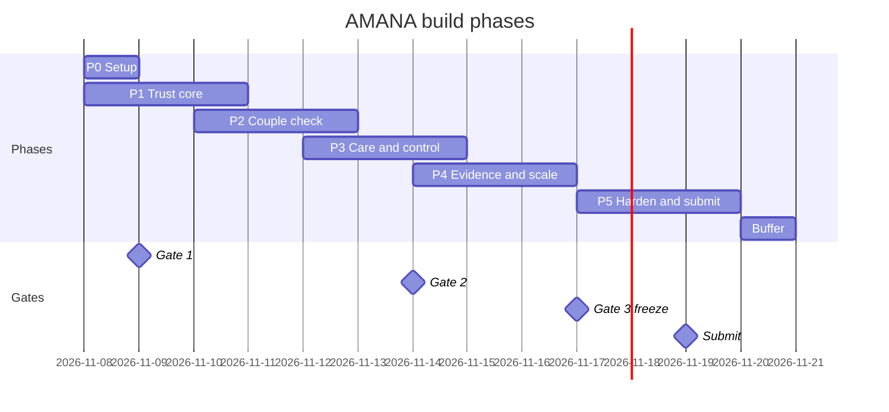

# AMANA: Build Phases

> The build split into phases, from **Sun 8 Nov 2026** to the deadline on **Fri 20 Nov 2026**.
> **Replans** the schedule in `blaze/idea/IMPLEMENTATION_PLAN.md`, written 4 Nov, since nothing has been built yet. Where the two disagree, **this file wins**.
> **Team (assumed):** A = ML/LLM · B = full-stack (wallet + private check) · C = full-stack (backend + console + infra) · D = design + clinical content + pitch.
> **Related docs:** `PRD.md` (features and acceptance tests) · `architecture.md` · `rules.md` · `design.md`.

---

## 0. What changed because we start on 8 Nov

- **Time left:** 12 days instead of 16. At about 3.5–4 hours per person per day, that's roughly **170–190 person-hours**, not 250.
- **Cut now** (were stretch anyway): Arabic read-aloud (I-F11) and a real FHIR server. We use FHIR-shaped bundles.
- **Only if Gate 2 is green:** family invites (I-F9).
- **Reduced:**
  - Condition cards go from 25 to **15** reviewed cards, covering the most common conditions; the dashboard reports coverage honestly.
  - Tier 2 counselling becomes a routing label and a booking option, with no group-session feature.
  - The country pack switch shows a config file swap with a second pack; no admin screen.
- **Registration closes Tue 10 Nov.** Register **today**.

---

## 1. Phase overview

| Phase | Dates | Goal | Ends with |
|---|---|---|---|
| **P0 Setup** | Sun 8 Nov | Team registered; repo and environments ready; external checks started | Registration confirmed; repo runs locally |
| **P1 Trust core** | Sun 8 – Tue 10 Nov | Lab issuer, national token service, synthetic population; prove the private check works | **Gate 1 (Mon 9 Nov):** private check works in browser or fallback chosen |
| **P2 Couple check** | Tue 10 – Thu 12 Nov | Wallet stores results; two phones pair and get "shared risk: yes/no"; cheats rejected | Two phones run a real check; attack demo works |
| **P3 Care and control** | Thu 12 – Sat 14 Nov | Consent and reveal, programme mode, explainer, counsellor console | **Gate 2 (Sat 14 Nov):** full demo end to end on staging |
| **P4 Evidence and scale** | Sat 14 – Mon 16 Nov | User test, red-team, load test, dashboard, deploy, country pack | **Gate 3 (Tue 17 Nov, morning):** feature freeze |
| **P5 Harden and submit** | Tue 17 – Thu 19 Nov | Bug bash, docs, video, deck, submission | Submitted Thu 19 Nov evening |
| **Buffer** | Fri 20 Nov | Official deadline | Nothing new |

Phases overlap by half a day on purpose: one person can finish the last phase's work while others start the next.

---

## 2. P0: Setup (Sun 8 Nov)

**Goal:** nobody is blocked tomorrow.

| Owner | Tasks |
|---|---|
| **D** | **Register the team on Hack2skill (closes Tue 10 Nov).** Contact 3 clinical genetics advisors. Start recruiting 25 user-test participants (to end with at least 20). Draft the user-test consent form. |
| **C** | Create the repo with the folder layout from `architecture.md` §7. CI running lint and tests. Docker Compose with Postgres. Azure resource group, Key Vault and Postgres in UAE North. |
| **A** | Check Azure OpenAI model availability in UAE North (record the answer in `docs/decisions.md`). Start the gene list (CTGA conditions × panel) and the ClinVar download. |
| **B** | Start the private-check spike: count-only check between two browser tabs. |

**Exit criteria**
- [ ] Registration submitted and confirmed by email or on the platform.
- [ ] Repo cloned and running locally by all four people.
- [ ] Azure region answer recorded.
- [ ] Advisor and participant outreach sent.

---

## 3. P1: Trust core (Sun 8 – Tue 10 Nov)

**Goal:** the pieces that make the privacy promise real.
**Features:** I-F1 Lab issuer · I-F12 National token service · I-F2 Synthetic population · I-F4 spike.

| Owner | Tasks |
|---|---|
| **B** | Finish the browser spike. **Gate 1 on Mon 9 Nov:** if the browser library fails on a phone, switch to the Python helper service per wallet. Start the wallet shell (right-to-left layout, translation files, installable). |
| **C** | National token service: one key in Key Vault, periods, lab registry, refuse unregistered labs. Lab issuer: signed credentials; token request. Cross-lab test (two labs → same tokens). |
| **A** | Synthetic population: carrier frequencies, families, marriages with a cousin-marriage mix, calibration toward 4.8%. Export 10,000 people / 5,000 couples. |
| **D** | Card template. First 5 cards drafted in Arabic and English. Wireframes for the 8 core wallet screens (see `design.md`). |

**Deliverables**
- Token service and lab issuer running locally and on staging.
- Synthetic population v1 with a reproducible seed.
- Gate 1 decision recorded.

**Exit criteria**
- [ ] A synthetic person gets a signed credential with national tokens.
- [ ] Same gene, two labs, same token (automated test).
- [ ] Unregistered lab refused; token for a gene not in the credential refused.
- [ ] Simulated incompatible rate within ±1.5 points of 4.8%.
- [ ] Gate 1 decided (browser library or helper service).

**Risks in this phase:** private-check library friction (R1); Azure model region (R11).

---

## 4. P2: Couple check (Tue 10 – Thu 12 Nov)

**Goal:** the core demo moment: two phones, one private answer, cheats rejected.
**Features:** I-F3 Wallet · I-F4 Private check · I-F8 Attack demo · I-F14 sign-in mock.

| Owner | Tasks |
|---|---|
| **B** | Wallet imports, verifies and encrypts the credential. "My result" screen. QR pairing. Count-only check end to end on two phones. Token-set signature check; forged tokens rejected. Attack demo: "claim every gene on the panel" rejected, side-by-side with plain matching that leaks. |
| **C** | Relay: one-time sessions, 5-minute expiry, rate limits, no storage. Mock national-ID sign-in. Records-exchange adapter delivering FHIR bundles. Log scrubber + log-scan test in CI. |
| **A** | Explainer v0: card store, AI rewording, fact-checker v0. Red-team set v1 (50 prompts). |
| **D** | Cards 6–10. Hi-fi designs for pairing, check result and reveal. Reveal and consent copy reviewed for neutral wording. Confirm advisor (fallback R3 if none by Tue 10 Nov). |

**Deliverables**
- Wallet on staging, installable, Arabic and English.
- Relay on staging.
- Attack demo screen.

**Exit criteria**
- [ ] Two phones pair by QR and get "shared risk: yes/no".
- [ ] 1,000 synthetic couples: every shared-gene couple found, no false alarms.
- [ ] Forged token set rejected; all-genes attack rejected with logged reason.
- [ ] Relay log scan finds no gene names or token values.
- [ ] Sign-in works through the mock adapter.

**Risks:** phone camera or WebSocket issues on iOS; time overrun on the wallet.

---

## 5. P3: Care and control (Thu 12 – Sat 14 Nov)

**Goal:** everything around the check: consent, reveal, programme mode, explanation, counselling.
**Features:** I-F5 Consent + audit · I-F13 Programme mode · I-F6 Explainer + teach-back · I-F7 Counsellor console · I-F15 Content pipeline (lite).

| Owner | Tasks |
|---|---|
| **C** | Consent ledger: permissions, revoke, expiry, tamper-evident audit chain. Counsellor console: tiered queue, case detail, copilot summary, sign-off. Case appears within 5 s of consent. |
| **B** | Two-step reveal (intersection mode after both consents). Programme-mode screens, including "compatible but carrier". Sharing and audit log screen. Delete-my-data. |
| **A** | Fact-checker finished. Red-team set to 100 prompts; first full run and fixes. Teach-back storage. Evaluation harness: correctness on 5,000 couples. |
| **D** | Cards 11–15. Teach-back questions for all cards. Advisor review of cards. Content pipeline status (reviewed / pending). Pitch outline. |

**Gate 2 (Sat 14 Nov): full demo run on staging**
Run the demo script from `design.md` §8 end to end:
- Sign in → my result → teach-back → pair → check → reveal → counsellor case → sign-off → audit log → attack demo.

| Gate 2 result | Action |
|---|---|
| Green: whole script works | Start family invites (I-F9) only if one person has spare time |
| Amber: one step broken | Fix in P4; no stretch work |
| Red: several steps broken | Drop the country-pack demo and Tier 2; B helps C; record cuts in `docs/limitations.md` |

**Exit criteria**
- [ ] Revoked or expired permission blocks access; tampering detected.
- [ ] Reveal only after both consents.
- [ ] Carrier in a "compatible" couple gets their own card; incompatible routes to Tier 3.
- [ ] 1,000 simulated cases routed to the right tier.
- [ ] "Clinical advice" label impossible without sign-off.
- [ ] 15 cards in Arabic and English with review status shown.

---

## 6. P4: Evidence and scale (Sat 14 – Mon 16 Nov)

**Goal:** proof. Numbers for every judging criterion.
**Features:** I-F10 Evaluation + scale dashboard · I-F16 Country packs (lite) · deployment.

| Owner | Tasks |
|---|---|
| **D** | Run the user test: at least 20 adults, Arabic and English, mixed education, with persona cards. Teach-back before and after, compared with a plain lab letter. Draft the 1-page pilot proposal. |
| **A** | Dashboard: correctness, privacy tests, red-team results, understanding before/after, fairness by language and literacy (groups under 5 hidden). Second red-team run. |
| **C** | Deploy to the demo environment in UAE North with seeded personas. Load test at 10,000 then 100,000 couple checks; cost per couple per year in AED. Second country pack; config swap demo. |
| **B** | Offline demo mode (laptop hotspot). Test on one mid-range Android phone and one iPhone. Fix Gate 2 issues. |

**Gate 3 (Tue 17 Nov, morning): feature freeze**
- Every MVP feature passes its acceptance test in `PRD.md` §6, **or** is cut and listed in `docs/limitations.md`.
- After this: bug fixes, docs and pitch only.

**Exit criteria**
- [ ] At least 20 user-test participants done (or fallback R7: report as feasibility pilot with ranges, add simulated cases).
- [ ] Red-team: 0 unsupported claims and 0 directive statements, reviewed by 2 people (or fallback R2: turn off rewording).
- [ ] Load-test numbers recorded (100,000, or 10,000 extrapolated and labelled as such).
- [ ] Demo environment live with seeded personas.
- [ ] Offline demo works.

---

## 7. P5: Harden and submit (Tue 17 – Thu 19 Nov)

**Goal:** a clean, honest, complete submission.

| Day | A | B | C | D |
|---|---|---|---|---|
| **Tue 17** | Model card; final evaluation numbers | Bug bash; record backup demo video | Architecture, threat model, integration and data-map docs | Pitch deck v1; video script |
| **Wed 18** | Limitations and assumptions doc | Final device testing | Deployment guide | Record 3-minute video; Arabic/English proofread |
| **Thu 19** | Final check of dashboard numbers | Final dry run | **Submit** | Final dry run; re-check the 3 unopened sources before they appear in the deck |

**Submission checklist** (required: prototype + technical documentation + assumptions, dependencies, limitations)
- [ ] Prototype URL + demo personas
- [ ] 3-minute video + backup demo recording
- [ ] Pitch deck
- [ ] Technical docs: architecture, threat model, integration, deployment guide
- [ ] Model card
- [ ] Data map with every source
- [ ] Evaluation report: correctness, cross-lab, privacy, safety, understanding, fairness, scale
- [ ] Assumptions, dependencies, limitations (mocks, honest-but-curious assumption, patent check, Emirati Genome Programme not verified)
- [ ] 1-page pilot proposal
- [ ] Repo ready to share if requested

---

## 8. Buffer (Fri 20 Nov)

Official deadline. Use only to fix a failed submission upload or a broken link. No new features.

---

## 9. Feature-to-phase map

| Feature | Phase | Owner |
|---|---|---|
| I-F1 Lab issuer | P1 | C |
| I-F12 National token service | P1 | C |
| I-F2 Synthetic population | P1 | A |
| I-F3 Wallet | P1 shell → P2 | B |
| I-F4 Private check | P1 spike → P2 | B |
| I-F8 Attack demo | P2 | B |
| I-F14 Adapters (mock) | P2 | C |
| I-F5 Consent + audit | P3 | C |
| I-F13 Programme mode | P3 | B |
| I-F6 Explainer + teach-back | P2 → P3 | A + D |
| I-F7 Counsellor console | P3 | C |
| I-F15 Content pipeline (lite) | P1 → P3 | D + A |
| I-F10 Evaluation + scale dashboard | P3 harness → P4 | A (+ C for load test) |
| I-F16 Country packs (lite) | P4 | C |
| I-F9 Family invites | Only after green Gate 2 | B |
| I-F11 Read-aloud | Cut | — |

---

## 10. Cut order (if a phase runs late)

Cut from the top first:
1. Family invites (I-F9)
2. Country-pack live swap (keep the config file and a slide)
3. Tier 2 as a separate route (merge into Tier 1 + "ask a question")
4. 100,000-couple load test (report 10,000 and extrapolate, labelled as such)
5. Cards beyond the top 10

**Never cut:** private check · lab-signed national tokens · attack demo · consent + audit log · reviewed cards with fact-check · counsellor sign-off · programme mode · evaluation numbers.

---

## 11. Risk triggers by phase

| Phase | Risk | Trigger | Action |
|---|---|---|---|
| P0 | Registration missed | Not confirmed by Mon 9 Nov | Everyone stops and fixes it; deadline Tue 10 Nov |
| P0 | Azure model not in UAE North | Day-1 check | Nearest region; synthetic data only; documented |
| P1 | Private check fails in browser (R1) | Gate 1 red | Helper service per wallet |
| P2 | No clinical advisor (R3) | None by Tue 10 Nov | Cards from GeneReviews / MedlinePlus, marked "pending clinical review" |
| P3 | Demo not end to end | Gate 2 red | Apply cut order; B helps C |
| P4 | Too few test users (R7) | Under 20 by Mon 16 Nov | Feasibility pilot with ranges + simulated cases |
| P4 | Explainer unsafe (R2) | Red-team not clean by Mon 16 Nov | Turn off rewording; reviewed cards only |
| P5 | "Marriage filtering" perception (R4) | Pitch review flags it | Rework copy; lead with understanding and counselling outcomes |
